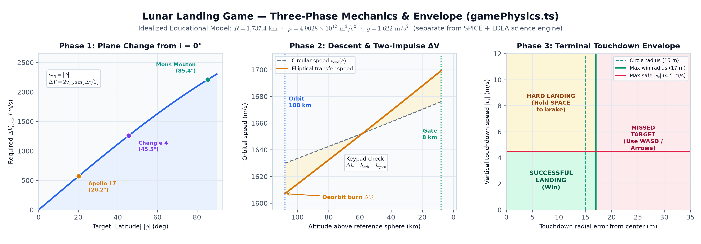
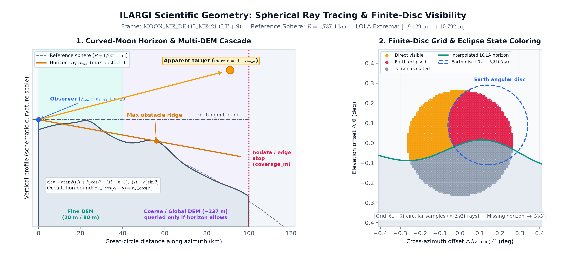
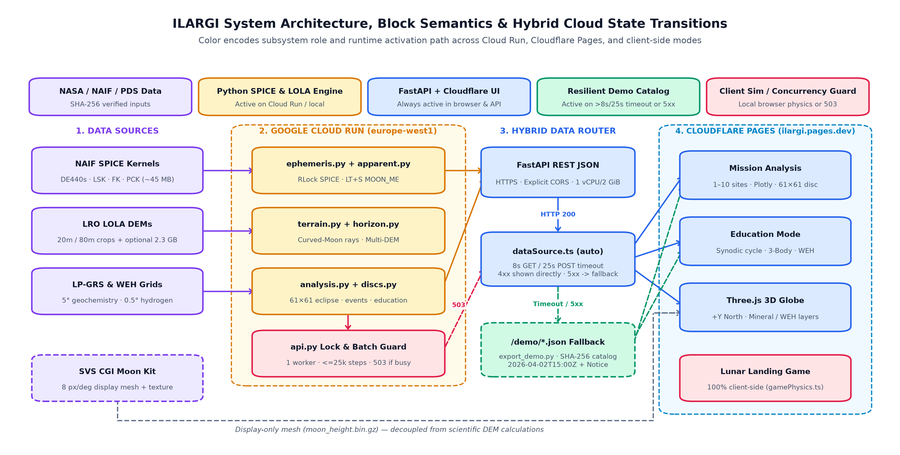

# ILARGI

**Interactive Lunar Analyzer for Radiance, Geometry, and Intervisibility** — a NASA Space Apps project for exploring solar illumination, Earth visibility, surface geochemistry, and lunar orbital/landing mechanics across real lunar terrain.

[](https://ilargi.pages.dev/)
[](https://ilargi-api-l4mfoqterq-ew.a.run.app/api/health)
[](pyproject.toml)
[](web/package.json)

- **Live Web Application (Cloudflare Pages):** https://ilargi.pages.dev/
- **Scientific Backend API (Google Cloud Run, `europe-west1`):** https://ilargi-api-l4mfoqterq-ew.a.run.app/api/health
- **Offline/Cold-Start Resilience:** Automatically falls back to a SHA-256-verified catalog of precomputed engine outputs (`web/public/demo/`) whenever the live API times out or is temporarily unavailable.

---

## What ILARGI Does

ILARGI serves two complementary audiences from a unified 3D lunar observatory while keeping scientific modeling strictly separated from display approximations:

### Experience 01 — Education Mode & Lunar Landing Game

Designed for students, outreach, and intuitive conceptual exploration:

- **Interactive Synodic Cycle (`~708.73 h`):** Scrub or animate a full lunar day across 23 curated landmarks (Peaks of Eternal Light, Permanently Shadowed Regions, Apollo/Luna/Chang'e landing sites, and laser retroreflectors), with quick presets for New Moon, First Quarter, Full Moon, and Last Quarter.
- **Synchronized 3-Body Orbit Mini-View:** Visualizes instantaneous `J2000` Sun–Earth–Moon geometry alongside local surface illumination in `MOON_ME_DE440_ME421`.
- **Subsurface & Resource Context:** Toggles Lawrence et al. (2022) water-equivalent hydrogen (WEH) overlays across the 3D globe and surfaces spacecraft classroom guides (`docs/classroom-spacecraft.md`).
- **3-Phase Lunar Landing Game (100% Client-Side):** An interactive physics challenge (`R = 1,737.4 km`, `μ = 4.9028 × 10¹² m³/s²`, `g = 1.622 m/s²`) embedded inside Education mode:
  1. **Phase 1 — Orbital Plane Change:** Pick a target on the 3D Moon, compute the required inclination $i = |\phi|$ on the spacecraft keypad, and watch the equatorial parking orbit tilt over the landing site.
  2. **Phase 2 — Two-Impulse Descent:** Calculate the altitude drop $\Delta h = h_{\text{orb}} - h_{\text{gate}}$ to trigger a Hohmann transfer down to the terminal landing gate.
  3. **Phase 3 — Terminal Touchdown (`175 m → 0 m`):** Steer laterally over lunar craters using `WASD`/Arrow keys and hold `SPACE` to fire braking thrusters, landing inside the `15 m` (`±2 m` tolerance) target zone at `|v_z| <= 4.5 m/s`.



### Experience 02 — Mission Analysis (Technical Site Explorer)

Designed for engineering trade studies and illumination/communications planning across **1 to 10 lunar sites simultaneously**:

- **High-Precision Ephemerides:** Uses NAIF SPICE (`de440s.bsp`, `naif0012.tls`, `moon_pa_de440_200625.bpc`, `moon_de440_250416.tf`, `pck00011.tpc`) with `LT+S` aberration from the observer locus in `MOON_ME_DE440_ME421`.
- **Curved-Moon Spherical Horizons:** Traces great-circle rays across LRO LOLA Digital Elevation Models (cascading `20 m` / `80 m` polar DEMs into `~237 m` global coverage where needed) and records explicit `coverage_m` bounds whenever rasters end.
- **Finite-Disc & Eclipse Modeling:** Discretizes the Sun (`695,700 km`) and Earth (`6,371.0 km`) onto a `61 × 61` tangent-plane ray grid to compute `above_horizon_fraction`, `eclipsed_fraction`, and `direct_visible_fraction`.
- **Visibility Spans, Geochemistry & Export:** Computes sunrise/sunset and Earthrise/Earthset crossings, continuous power/comms outage spans, LP-GRS 5° elemental abundances (`Al`, `Ca`, `FeO`, `Th`) + `0.5°` WEH concentrations, interactive Plotly sky/daily evolution charts, and CSV downloads.



---

## System & Hybrid Cloud Architecture

The diagram below shows how authoritative NASA/NAIF/PDS datasets, the Python scientific engine on Google Cloud Run, the `dataSource.ts` resilient router, and the React/Three.js frontend on Cloudflare Pages interact at runtime. Colors distinguish external sources, live backend calculation, edge UI, resilient static fallback, and client-side simulation/guards.



For deeper module-by-module walkthroughs, API schemas, and frame transformation diagrams, see [Codebase architecture and module guide](docs/codebase-architecture.md) and [Scientific architecture and presentation guide](docs/scientific-architecture.md).

---

## Visual Showcase & Screenshot Checklist

Before final submission, capture clean screenshots (or short `.mp4` clips) of the running app at **https://ilargi.pages.dev/** and place them under `docs/media/` using these suggested targets:

| Planned Asset Path                | View / Mode to Capture             | What Should Be Visible                                                               |
| --------------------------------- | ---------------------------------- | ------------------------------------------------------------------------------------ |
| `docs/media/home-observatory.png` | Home Landing View                  | ILARGI hero observatory card, live/fallback status, and Experience 01 / 02 selectors |
| `docs/media/education-cycle.png`  | Education Mode (`Experience 01`)   | 3D Moon illuminated at First/Full Quarter, WEH overlay active, and 3-body orbit card |
| `docs/media/landing-game.png`     | Lunar Landing Game (`Phase 1 / 3`) | Tilted 3D parking orbit + calculator keypad or Phase 3 downward crater landing HUD   |
| `docs/media/mission-analysis.png` | Mission Analysis (`Experience 02`) | Multi-site 3D pins, Plotly sky/elevation track, and `61 × 61` finite-disc inspector  |

> [!TIP]
> **Embedding Screenshots & Video on GitHub:** Once screenshots are saved to `docs/media/`, embed them right here using ``. For demo videos (`>10 MB`), either drag-and-drop a compressed H.264 `.mp4` directly into GitHub's web markdown editor (hosted on GitHub's CDN without bloating Git history) or upload to YouTube and link a clickable thumbnail badge (`[](https://youtu.be/YOUR_ID)`).

---

## Repository & Codebase Overview

| Path                    | Purpose                                                                                                |
| ----------------------- | ------------------------------------------------------------------------------------------------------ |
| `main.py`               | Local entry point starting Uvicorn on `127.0.0.1:8000` with `ilargi.api:app`                           |
| `Dockerfile`            | Production `python:3.13-slim` container for Cloud Run (bundles SHA-256-verified kernels + LOLA crops)  |
| `ilargi/`               | Scientific backend: SPICE sessions, apparent angles, LOLA horizons, `61×61` discs, LP-GRS/WEH, FastAPI |
| `web/src/`              | React 19 + TypeScript UI: Three.js 3D globe, Plotly charts, Landing Game, `dataSource.ts` router       |
| `web/public/demo/`      | Precomputed SHA-256-indexed real backend catalog used for static/resilient fallback                    |
| `web/public/textures/`  | 8 px/deg NASA SVS CGI Moon Kit display DEM (`moon_height.bin.gz`), albedo, bump, and WEH textures      |
| `data/materials/`       | Versioned PDS LP-GRS 5° equal-area abundance table & Lawrence et al. (2022) 0.5° hydrogen grid         |
| `data/terrain/`         | Versioned 20 m and 80 m south-pole LOLA sample crops (`ldem_128.vrt` for optional global DEM)          |
| `scripts/`              | Cloud Run / Cloudflare Pages deploy scripts, WEH texture builder, and Matplotlib figure generator      |
| `tests/` & `web/tests/` | Python `pytest` suite (physics, API, deployment manifest integrity) + TypeScript & Playwright E2E      |

---

## Code Dependencies & Technology Stack

All software dependencies are explicitly locked in [`uv.lock`](uv.lock), [`package-lock.json`](package-lock.json), and [`web/package-lock.json`](web/package-lock.json). Full citations, SHA-256 digests, and dataset provenance are cataloged in [Sources and provenance](docs/sources.md#software-dependencies).

### Python Backend (`pyproject.toml` · Python `>=3.13`)

| Layer                | Package (Locked)                                                                   | Purpose in Product                                                                              |
| -------------------- | ---------------------------------------------------------------------------------- | ----------------------------------------------------------------------------------------------- |
| Ephemeris & Frames   | `spiceypy` (`8.4.0`)                                                               | NASA NAIF CSPICE bindings (`MOON_ME_DE440_ME421`, `LT+S` apparent target vectors, `UTC` → `ET`) |
| Topography & CRS     | `rasterio` (`1.5.2`), `pyproj` (`3.8.0`)                                           | LOLA GeoTIFF / `.img` / `.vrt` raster I/O and spherical `+R=1737400 m` CRS validation           |
| Numerical & Data     | `numpy` (`2.5.4`), `pandas` (`3.1.1`), `scipy` (`1.18.1`)                          | Curved-Moon ray tracing, `61 × 61` finite-disc grids, LP-GRS tables, morphological hillshades   |
| Visualization        | `matplotlib` (`3.11.2`)                                                            | Static terrain PNG exports (`ilargi.terrain_image`) & documentation diagrams                    |
| Web API & Validation | `fastapi` (`0.163.0`), `pydantic` (`2.14.3`), `uvicorn` (`0.54.0`)                 | REST endpoints, request budgets, CORS, and ASGI HTTP serving (`main.py` & Cloud Run)            |
| Dev / QA / Lint      | `pytest` (`9.2.0`), `httpx2` (`2.16.0`), `ruff` (`0.17.5`), `pre-commit` (`4.7.0`) | Scientific & API test suite, lint/formatting, and local git hooks                               |

### Frontend & Tooling (`web/package.json` & `package.json` · Node.js `22`)

| Layer                | Package (Locked)                                                                       | Purpose in Product                                                                             |
| -------------------- | -------------------------------------------------------------------------------------- | ---------------------------------------------------------------------------------------------- |
| UI Framework         | `react` (`19.3.1`), `react-dom` (`19.3.1`), `lucide-react` (`0.511.0`)                 | Lazy-loaded Experience 01 / 02 workspaces, state controls, and UI iconography                  |
| 3D Lunar Observatory | `three` (`0.176.0`)                                                                    | Interactive 3D Moon relief mesh, dynamic Sun/Earth lighting, WEH/LP-GRS layers, Phase 1 orbit  |
| Scientific Plotting  | `plotly.js-gl2d-dist-min` (`3.7.0`)                                                    | WebGL-accelerated sky-azimuth, daily evolution, and multi-site comparison charts               |
| Build & Type-Check   | `vite` (`6.4.6`), `@vitejs/plugin-react` (`4.7.0`), `typescript` (`5.9.3`), `@types/*` | `/api` dev proxy, code-split production bundles, and strict TypeScript compilation             |
| Testing & Formatting | `tsx` (`4.23.15`), `@playwright/test` (`1.65.1`), `prettier` (`3.10.1`)                | Unit tests (`web/tests/`), Chromium E2E offline-fallback verification (`web/e2e/`), formatting |
| Cloud & Container    | `wrangler` (`4.162.0`), `python:3.13-slim`, `uv` (`0.9.20`), `libexpat1`               | Cloudflare Pages upload + Google Cloud Run Docker runtime (`libexpat1` required by GDAL/VRT)   |

> [!NOTE]
> Typography combines Google Fonts (`Inter` and `JetBrains Mono`, loaded via [`web/index.html`](web/index.html)) with the bundled display typeface [`web/public/fonts/Vasca.ttf`](web/public/fonts/Vasca.ttf).

---

## Run Locally from Original Sources

All scientific kernels and elevation datasets are downloaded and SHA-256-verified directly from **official NASA/NAIF/PDS sources**—no private local folders or pre-populated machine caches are required.

### 1. Prerequisites

- **Git**
- **Python 3.13** and **[uv](https://docs.astral.sh/uv/)**
- **Node.js 22+** with **npm**

### 2. Clone and Install Dependencies

```powershell
git clone https://github.com/ChristianGonper/ILARGI-Project.git
cd ILARGI-Project

uv sync --locked
npm ci
npm --prefix web ci
```

### 3. Download Official NASA Data

1. **NAIF SPICE Kernels (~45 MB, required for live calculation):**
   Downloads `de440s.bsp`, `naif0012.tls`, `moon_pa_de440_200625.bpc`, `moon_de440_250416.tf`, and `pck00011.tpc` directly from `https://naif.jpl.nasa.gov/pub/naif/generic_kernels/`, verifies SHA-256 digests, and stores them in `data/kernels/` and `~/.ilargi/kernels` (override via `ILARGI_KERNEL_DIR`):

   ```powershell
   uv run python -m ilargi.kernels
   ```

2. **LRO LOLA Elevation Models (sample south-pole crops included; full ~2.3 GB DEMs optional):**
   The repository already ships 20 m and 80 m south-pole LOLA GeoTIFF crops under `data/terrain/` so south-polar analyses and tests run immediately. To download the full `LDEM_80S_80MPP_ADJ.TIF` (NASA PGDA) and global `ldem_128.img` (PDS Geosciences) rasters into `~/.ilargi/terrain` (override via `ILARGI_TERRAIN_DIR`):

   ```powershell
   uv run python -m ilargi.download_terrain
   ```

### 4. Build and Run

```powershell
npm --prefix web run build
uv run python main.py
```

Open **http://127.0.0.1:8000** in your browser. FastAPI serves both `/api/*` and the built `web/dist` bundle.

For frontend development with hot module reload, run the backend in one terminal (`uv run python main.py`) and Vite in a second terminal (`npm --prefix web run dev`); Vite automatically proxies `/api` requests to port `8000`.

---

## Deployment Architecture (Cloudflare Pages + Google Cloud Run)

ILARGI runs a split hybrid deployment so heavy SPICE/GDAL/LOLA computations stay in a constrained Python container while the frontend remains globally fast and resilient:

- **Frontend (`https://ilargi.pages.dev/`):** Deployed on **Cloudflare Pages** (project `ilargi`, built with `VITE_DATA_MODE=auto` and `VITE_API_BASE_URL=https://ilargi-api-l4mfoqterq-ew.a.run.app`) via `scripts/deploy-pages.ps1` or `.github/workflows/deploy-pages.yml`.
- **Backend (`https://ilargi-api-l4mfoqterq-ew.a.run.app`):** Deployed on **Google Cloud Run** (project `ilargi-space-apps-2026`, region `europe-west1`, service `ilargi-api`) from `Dockerfile` using `scripts/deploy-cloud-run.ps1`. Runs as non-root UID `10001`, `1 vCPU`, `2 GiB RAM`, `1` Uvicorn worker, `concurrency=1`, `0–2` instances, `120 s` timeout, explicit CORS, and bundled verified kernels + south-pole LOLA crops.
- **Automatic Fallback:** If Cloud Run is cold-starting, busy (`HTTP 503` calculation lock), or exceeds the `8 s` (`GET`) / `25 s` (`POST`) browser timeout, `web/src/dataSource.ts` serves matching catalog outputs from `web/public/demo/` and displays a clear notice.

Operational runbooks and reproduction commands are in [Deployment Guide](docs/deployment/README.md) and [Live Deployment Status](docs/deployment/live.md).

---

## Verification & Utility Commands

### Run Automated Checks

```powershell
uv run --locked pytest -q
uv run --locked ruff check .
uv run --locked ruff format --check .
npm --prefix web test
npm --prefix web run build
```

For browser end-to-end tests (testing fallback behavior with mocked/offline APIs):

```powershell
npx --prefix web playwright install chromium
npm --prefix web run test:e2e
```

Enable pre-commit hooks (`ruff` + `prettier`) once per clone with `uv run pre-commit install`.

### Optional Data & Figure Export Utilities

- **Regenerate documentation figures** (`docs/diagrams/*.png`):
  ```powershell
  uv run python scripts/generate_doc_figures.py
  ```
- **Regenerate static demo catalog** (`web/public/demo/*.json`):
  ```powershell
  uv run python -m ilargi.export_demo
  ```
- **Export static LOLA elevation/hillshade PNGs** (defaults to `89.5° S, 0° E`; optional `--relief` uses `2×` illustrative vertical exaggeration):
  ```powershell
  uv run python -m ilargi.terrain_image --dem 20 --output outputs/lola-20m.png
  uv run python -m ilargi.terrain_image --dem 20 --relief --window-km 5 --output outputs/lola-detail.png
  ```
- **Regenerate 3D globe display DEM** (`web/public/textures/moon_height.bin.gz`, 8 samples/degree from NASA SVS CGI Moon Kit, decoupled from scientific DEMs):
  ```powershell
  uv run python -m ilargi.build_globe_terrain <source.tif>
  ```

---

## Documentation Index

- **Architecture & Engineering:**
  - [Codebase architecture and module guide](docs/codebase-architecture.md)
  - [Scientific architecture and presentation guide](docs/scientific-architecture.md)
  - [Development guide](docs/development.md)
  - [Deployment guide](docs/deployment/README.md) & [Live deployment state](docs/deployment/live.md)
- **Science, Geometry & Validation:**
  - [Project concept and scope](docs/project-concept.md)
  - [Scientific results and limitations](docs/scientific-results.md)
  - [Apparent geometry](docs/apparent-geometry.md)
  - [Terrain and horizons](docs/terrain-and-horizons.md)
  - [Ephemeris validation](docs/ephemeris-validation.md)
  - [Lunar materials (LP-GRS & WEH)](docs/lunar-materials.md)
- **Education, Data & Provenance:**
  - [Classroom spacecraft guide](docs/classroom-spacecraft.md)
  - [Terrain data provenance](data/terrain/README.md)
  - [Sources and provenance](docs/sources.md)
