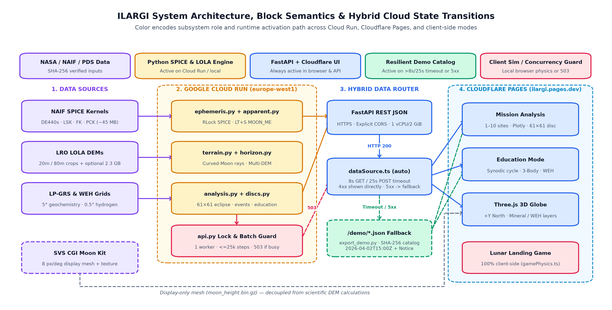
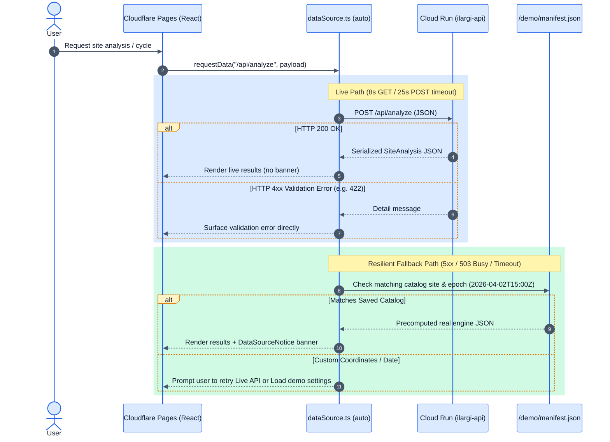
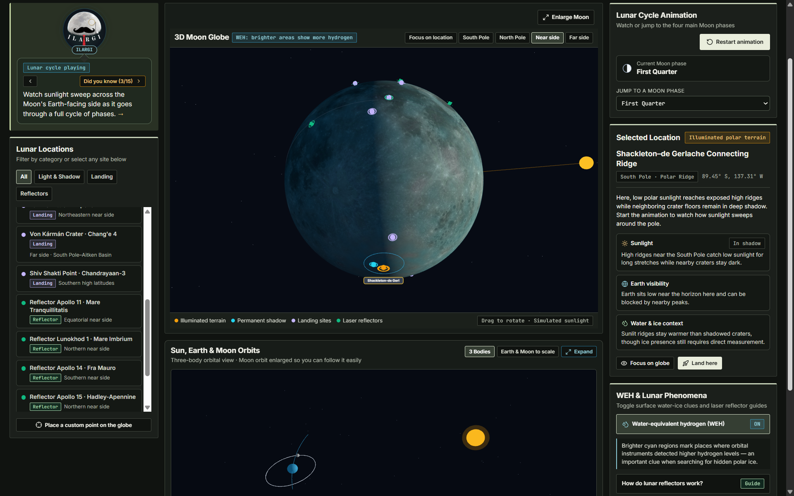
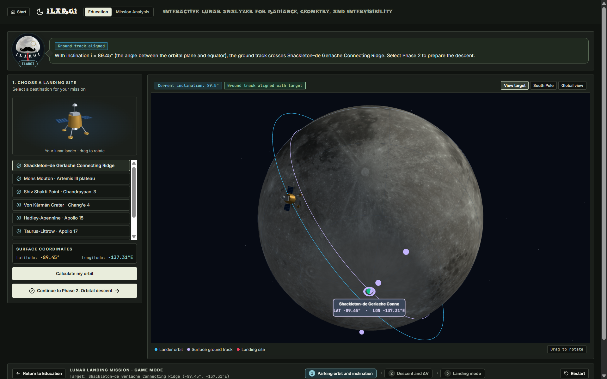
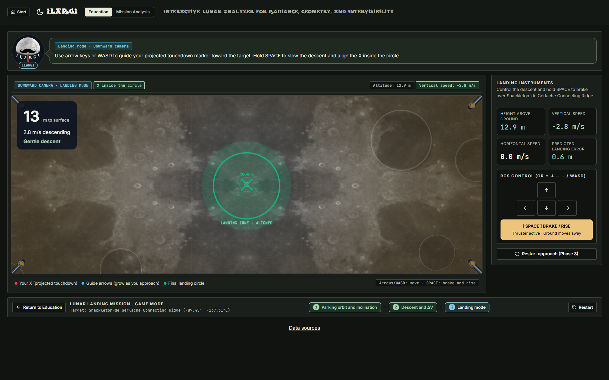
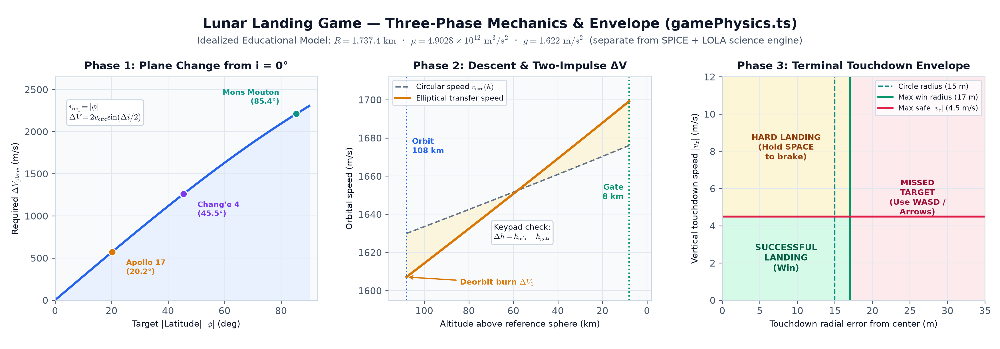

# Codebase architecture and module guide

This guide documents how ILARGI's Python scientific engine, FastAPI transport, React/Three.js frontend, and hybrid cloud deployment fit together. Rather than walking through code line by line, it describes each module's responsibility, data contracts, and runtime boundaries.



## 1. Repository layout

```text
ILARGI-Project/
├── main.py                        # Local FastAPI/Uvicorn entry point (127.0.0.1:8000)
├── Dockerfile                     # Python 3.13-slim production container for Cloud Run
├── ilargi/                        # Python scientific engine, FastAPI API, & CLI utilities
├── web/                           # React 19 + TypeScript + Three.js + Plotly.js frontend
│   ├── public/demo/               # Precomputed real API catalog for static/offline fallback
│   ├── public/textures/           # 3D display globe DEM, color, bump, and WEH textures
│   └── src/                       # Components, Three.js helpers, landing game, CSS layers
├── data/
│   ├── kernels/                   # Downloaded NAIF SPICE kernels (~45 MB, gitignored)
│   ├── materials/                 # PDS LP-GRS 5° table & Lawrence 2022 0.5° WEH grid
│   └── terrain/                   # Included 20m/80m south-pole crops, VRT, & full DEM cache
├── scripts/                       # WEH texture, doc-figure, & Cloud Run/Pages deploy scripts
├── docs/                          # Scientific, deployment, provenance, and figure docs
└── tests/                         # Python pytest suite (scientific, API, & deployment checks)
```

---

## 2. Backend scientific engine (`ilargi/`)

The Python backend separates pure scientific calculation from HTTP transport and from offline data-preparation CLIs.

### Ephemerides, frames, and apparent geometry

- [`ilargi/kernels.py`](../ilargi/kernels.py): Pins the five NAIF kernels (`de440s.bsp`, `naif0012.tls`, `moon_pa_de440_200625.bpc`, `moon_de440_250416.tf`, `pck00011.tpc`) with upstream JPL URLs and SHA-256 digests. Resolves kernels in order: `ILARGI_KERNEL_DIR` → `data/kernels/` → `~/.ilargi/kernels`. Running `python -m ilargi.kernels` downloads and verifies them directly from NAIF.
- [`ilargi/ephemeris.py`](../ilargi/ephemeris.py): Serializes all CSPICE calls behind a re-entrant lock (`spice_session()`), loads verified kernels once, validates timezone-aware UTC timestamps within `1972–2100`, and converts UTC to ET/TDB.
- [`ilargi/apparent.py`](../ilargi/apparent.py): Computes apparent Sun and Earth directions (`LT+S`) from a body-fixed surface observer (`spkcpo` with `OBSERVER` locus) in `MOON_ME_DE440_ME421` on the `1,737.4 km` reference sphere, projecting vectors onto analytical local North, East, and Up axes (`horizontal_angles`). Rejects exact `±90°` poles where local North is undefined.

### Topography, spherical horizons, and finite discs

- [`ilargi/terrain.py`](../ilargi/terrain.py): Discovers LOLA DEMs across `ILARGI_TERRAIN_DIR` (or `data/terrain/` then `~/.ilargi/terrain`), enforces strict CRS/meter-unit/north-up/spherical-radius validation (`dem_metadata`), handles cylindrical longitude wrapping for global rasters, and samples ground elevations (`sample_elevation`).
- [`ilargi/horizon.py`](../ilargi/horizon.py): Traces great-circle rays along discrete azimuths on the curved Moon. Uses physical occultation bounds ($r_{\max}\cos(\alpha + \theta) = r_{\text{obs}}\cos(\alpha)$) with LOLA global extrema (`+10,792 m`, `-9,129 m`) and supports multi-resolution DEM cascading (`calculate_multiresolution_horizon`), tightening per-azimuth bounds on the near DEM before querying the coarse DEM only where needed. Stops immediately at `nodata` or raster edges without extrapolating (`coverage_m`).
- [`ilargi/discs.py`](../ilargi/discs.py): Discretizes the Sun (`695,700 km`) and Earth (`6,371.0 km`) onto a `61 × 61` circular tangent-plane ray grid and tests each ray against the interpolated terrain horizon and Earth-overlap geometry to report `above_horizon_fraction`, `eclipsed_fraction`, and `direct_visible_fraction`.

### Time series, events, geochemistry, and orchestration

- [`ilargi/series.py`](../ilargi/series.py): Builds the `SUN` and `EARTH` sky-track `DataFrame` on 10-minute-multiple steps (up to 90 days / 3,000 samples), always including the exact requested final instant.
- [`ilargi/events.py`](../ilargi/events.py): Linearly interpolates `effective_margin_deg` zero-crossings (`sunrise`, `sunset`, `earthrise`, `earthset`), circularly interpolates crossing azimuths, and extracts contiguous dark/outage `ShadowSpan`s and intersection hours.
- [`ilargi/materials.py`](../ilargi/materials.py): Performs point-in-cell lookups on the `1,790`-cell PDS LP-GRS 5° equal-area table (converting `Al₂O₃`→`Al`, `CaO`→`Ca`, `FeO`, `Th` with global tercile binning) and the `0.5° × 0.5°` Lawrence et al. (2022) hydrogen grid (stoichiometric water-equivalent hydrogen).
- [`ilargi/models.py`](../ilargi/models.py): Immutable dataclasses (`SiteAnalysis`, `VisibilityEvent`, `ShadowSpan`, `IncidenceStats`, `MaterialsSummary`) separating domain results from API serialization.
- [`ilargi/sites.py`](../ilargi/sites.py): Curated catalogs for Mission Analysis (`HISTORICAL_SITES`, 11 locations) and Education (`EDUCATION_SITES`, 23 locations across illuminated peaks, PSRs, landing sites, and laser retroreflectors).
- [`ilargi/analysis.py`](../ilargi/analysis.py): Coordinates `analyze_site()` across DEM candidate resolution, horizon tracing, sky series, finite-disc eclipses, crossing intervals, solar incidence statistics, and geochemistry.
- [`ilargi/education.py`](../ilargi/education.py): Computes one synodic lunar cycle (`~708.734 h`) in a single SPICE session: optional coarse `5°` LOLA horizon (up to 120 km), lunar-center `LT+S` unit vectors in `MOON_ME_DE440_ME421` for 3D globe illumination, local site visibility, and instantaneous `J2000` (`NONE`) 3-body vectors + lunar phase fraction.

### HTTP transport & standalone CLI utilities

- [`ilargi/api.py`](../ilargi/api.py): FastAPI application exposing the REST API, single-calculation process lock (`HTTP 503` when busy), explicit CORS configuration (`ILARGI_CORS_ORIGINS`), and optional static serving of `web/dist/` for single-process local runs.
- [`ilargi/export_demo.py`](../ilargi/export_demo.py): Offline generator that runs `analyze_site()` and `compute_education_cycle()` against the versioned LOLA sample crops (`data/terrain/`) and writes SHA-256-indexed JSON payloads to `web/public/demo/`.
- [`ilargi/download_terrain.py`](../ilargi/download_terrain.py): Downloads and SHA-256-verifies the full polar (`LDEM_80S_80MPP_ADJ.TIF`) and global (`ldem_128.img`) LOLA products from NASA PGDA and PDS.
- [`ilargi/build_globe_terrain.py`](../ilargi/build_globe_terrain.py) & [`ilargi/terrain_image.py`](../ilargi/terrain_image.py): Standalone tools for regenerating the `web/public/textures/moon_height.bin.gz` display mesh and exporting static Matplotlib PNG elevation/hillshade maps.

---

## 3. Coordinate & frame transformation flow

The colored flowchart below shows how coordinates, frames, and display vs. scientific datasets flow through ILARGI, using light pastel blocks aligned with the runtime legend above:

```mermaid
%%{init: {'theme': 'base', 'themeVariables': {'background': '#ffffff', 'primaryTextColor': '#0f172a', 'lineColor': '#64748b'}}}%%
flowchart TB
    classDef ext fill:#ede9fe,stroke:#7c3aed,color:#0f172a,stroke-width:1.5px;
    classDef spice fill:#fef3c7,stroke:#d97706,color:#0f172a,stroke-width:1.5px;
    classDef topo fill:#d1fae5,stroke:#059669,color:#0f172a,stroke-width:1.5px;
    classDef api fill:#ffe4e6,stroke:#e11d48,color:#0f172a,stroke-width:1.5px;
    classDef ui fill:#dbeafe,stroke:#2563eb,color:#0f172a,stroke-width:1.5px;

    subgraph L["Legend: Block Color Semantics"]
        direction LR
        L1(["External NASA / NAIF / PDS"]) ::: ext
        L2["SPICE / Apparent Physics"] ::: spice
        L3[("Topography / Geochemistry")] ::: topo
        L4{{"FastAPI / Static Fallback"}} ::: api
        L5[["Browser 3D / Plotly / Game"]] ::: ui
    end

    K[("NAIF Kernels<br/>DE440s · LSK · FK · PCK")] ::: ext
    D[("LOLA DEMs<br/>20m / 80m Polar + 237m Global")] ::: ext
    G[("LP-GRS 5° &amp; WEH 0.5°")] ::: ext
    SVS[("NASA SVS CGI Moon Kit<br/>8 px/deg Display Mesh")] ::: ext

    K -->|"UTC → ET/TDB"| EP["ephemeris.py<br/>RLock SPICE Session"] ::: spice
    EP -->|"spkcpo LT+S<br/>OBSERVER locus"| AP["apparent.py<br/>MOON_ME_DE440_ME421"] ::: spice
    EP -->|"spkpos NONE<br/>J2000 Heliocentric"| ED["education.py<br/>3-Body &amp; Cycle Frames"] ::: spice

    D -->|"PROJ CRS Check<br/>1,737,400 m Sphere"| TR["terrain.py<br/>DE421 ME Raster"] ::: topo
    TR -->|"Great-Circle Rays<br/>Multi-DEM Cascade"| HR["horizon.py<br/>azimuth → elev_deg"] ::: topo
    AP -->|"Azimuth / Elevation"| AN["analysis.py + discs.py<br/>61×61 Disc + Intervals"] ::: spice
    HR --> AN
    G -->|"Point-in-Cell Lookup"| AN

    AN --> API{{"ilargi/api.py<br/>REST JSON"}} ::: api
    ED --> API
    AN -.->|"export_demo.py"| ST{{"web/public/demo/<br/>SHA-256 Catalog"}} ::: api

    API -->|"HTTPS or Fallback"| WEB[["React App &amp; Plotly.js<br/>Sky / Disc / Comparison"]] ::: ui
    ST -.-> WEB
    SVS -->|"moon_height.bin.gz<br/>Display Only"| TH[["Three.js Globe<br/>+Y North, +Z 0° Lon"]] ::: ui
    ED -->|"MOON_ME → Three.js<br/>Vector Swizzle"| TH
```

---

## 4. Web application (`web/`)

The frontend is a React 19 + TypeScript application bundled with Vite, keeping heavy Three.js and Plotly.js modules behind `React.lazy()` code-split boundaries so the home landing page loads immediately.

### Hybrid data layer & state flow

- [`web/src/dataSource.ts`](../web/src/dataSource.ts) & [`web/src/api.ts`](../web/src/api.ts): Implements `VITE_DATA_MODE` (`auto`, `live`, or `static`). In `auto` mode, GET requests time out at `8 s` and POST calculations at `25 s`; on HTTP `5xx`/`429`/`404`, network failure, or timeout, the client transparently falls back to `/demo/*.json` for matching catalog epochs and surfaces [`DataSourceNotice.tsx`](../web/src/components/DataSourceNotice.tsx).
- [`web/src/App.tsx`](../web/src/App.tsx): Manages the three top-level views (`home`, `education`, `pro`), multi-point state (`MAX_POINTS = 10`), mineral overlay toggles, and synchronization between the 3D globe and output panels.



### Experience 01: Education mode & Lunar Landing Game

- **Guided Globe & 3-Body View:** [`EducationWorkspace.tsx`](../web/src/components/EducationWorkspace.tsx), [`EducationMoonViewport3D.tsx`](../web/src/components/EducationMoonViewport3D.tsx), [`ThreeBodyOrbitMini.tsx`](../web/src/components/ThreeBodyOrbitMini.tsx), [`IlargiMascot.tsx`](../web/src/components/IlargiMascot.tsx), and [`SpacecraftGuide.tsx`](../web/src/components/SpacecraftGuide.tsx). Supports synodic cycle playback (`~708.7 h`), phase presets (New/First Quarter/Full/Last Quarter), the vivid WEH hydrogen layer ([`wehOverlay.ts`](../web/src/three/wehOverlay.ts)), laser retroreflector visualizations, and classroom spacecraft parameters ([classroom-spacecraft.md](classroom-spacecraft.md)).



- **Lunar Landing Game (`web/src/components/landing-game/`):** Runs entirely client-side using idealized circular/two-impulse lunar physics in [`gamePhysics.ts`](../web/src/components/landing-game/gamePhysics.ts) (`R = 1,737.4 km`, `μ = 4.9028 × 10¹² m³/s²`, `g = 1.622 m/s²`):
  - **Phase 1** ([`Phase1OrbitViewport3D.tsx`](../web/src/components/landing-game/Phase1OrbitViewport3D.tsx), [`SuperCalculator.tsx`](../web/src/components/landing-game/SuperCalculator.tsx)): Select a preset or click the 3D Moon, verify target coordinates on the calculator keypad, compute $i = |\phi|$ and plane-change $\Delta V$, and watch the equatorial parking orbit tilt to cross the site.
  - **Phase 2** ([`Phase2DescentView.tsx`](../web/src/components/landing-game/Phase2DescentView.tsx)): Compute the descent altitude step $\Delta h = h_{\text{orb}} - h_{\text{gate}}$ on the keypad to unlock the two-stage Hohmann/retro-braking animation to the landing gate.
  - **Phase 3** ([`Phase3LandingCanvas.tsx`](../web/src/components/landing-game/Phase3LandingCanvas.tsx)): Downward-camera 2D canvas from `175 m` altitude over `moon_color.jpg` + 240 procedural craters. Steer laterally with `WASD`/Arrows (`30 m/s²`) and hold `SPACE` to slow vertical descent (`-10.5 → -0.25 m/s`); touch down inside the `15 m` circle (`±2 m` tolerance) at `|vz| ≤ 4.5 m/s`.

| Phase 1 (3D Orbit Alignment)          | Phase 3 (Downward Landing Canvas)     |
| ------------------------------------- | ------------------------------------- |
|  |  |



### Experience 02: Mission Analysis (Technical Explorer)

- [`InputPanel.tsx`](../web/src/components/InputPanel.tsx): Configures 1–10 sites (presets or 3D pin-drop), UTC start dates, window duration, time step, instrument height, and LP-GRS/WEH overlays.
- [`MoonViewport3D.tsx`](../web/src/components/MoonViewport3D.tsx) & `web/src/three/`: Renders the 8-samples/deg (`~3.8 km/px`) LOLA relief mesh (`lunarTerrain.ts`), coordinate conversions (`moonCoordinates.ts`), camera tweening (`moonNavigation.ts`), and mineral/WEH overlays.
- [`OutputsPanel.tsx`](../web/src/components/OutputsPanel.tsx), [`ComparisonPanel.tsx`](../web/src/components/ComparisonPanel.tsx), [`SkyAzimuthPlot.tsx`](../web/src/components/SkyAzimuthPlot.tsx), [`DailyEvolutionPlot.tsx`](../web/src/components/DailyEvolutionPlot.tsx), and [`DiscVisibilityPanel.tsx`](../web/src/components/DiscVisibilityPanel.tsx): Interactive Plotly.js charts (with animated Sun/Earth sky markers over persistent trails), `61 × 61` finite-disc occlusion & eclipse inspector, dark-span & outage tables, and CSV export.

### Styling layers (`web/src/styles.css`)

`styles.css` loads five modular CSS files in deterministic cascade order—`foundation.css` (design tokens), `home.css`, `education.css`, `landing-game.css`, and `observatory.css`—followed by global focus-ring and `prefers-reduced-motion` accessibility rules.

---

## 5. REST API reference (`ilargi/api.py`)

| Endpoint                 | Method | Request / Query                                                                                     | Response Summary                                                                    |
| ------------------------ | ------ | --------------------------------------------------------------------------------------------------- | ----------------------------------------------------------------------------------- |
| `/api/health`            | `GET`  | —                                                                                                   | Kernel (`DE440s`), frame (`MOON_ME_DE440_ME421`), `LT+S`, and `dem_availability()`  |
| `/api/sites`             | `GET`  | —                                                                                                   | 11 curated `HISTORICAL_SITES` presets with coordinates and sample-coverage flags    |
| `/api/materials-overlay` | `GET`  | —                                                                                                   | Element metadata + 1,790 global LP-GRS 5° cells with tercile codes (`0–3`)          |
| `/api/analyze`           | `POST` | `points` (1–10), `duration_hours` (≤ 2160), `step_minutes` (10×), `instrument_height_m`, `dem_mode` | Full `SiteAnalysis` per point (horizon profile, sky series, disc fractions, events) |
| `/api/education/sites`   | `GET`  | —                                                                                                   | 23 `EDUCATION_SITES` across `eternal_light`, `psr`, `landing`, and `mirror`         |
| `/api/education/cycle`   | `POST` | `latitude_deg`, `longitude_east_deg`, `start_utc`, `duration_hours`, `step_minutes`                 | Synodic cycle frames (`sun_me_unit`, `earth_me_unit`, local sky, `J2000` 3-body km) |

> [!NOTE]
> `POST /api/analyze` enforces a combined batch budget (`len(points) * num_steps <= 25,000`) and a process-wide calculation lock so concurrent heavy requests return `HTTP 503` cleanly instead of exhausting container RAM.
