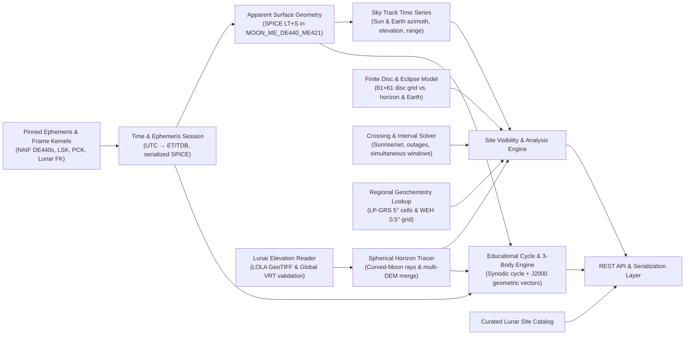

# Scientific architecture and presentation guide

ILARGI combines planetary ephemerides, spherical lunar topography, disc occultation geometry, and regional geochemistry behind a single web API. Both the technical **Mission Analysis** workspace and the **Education** experience query the same scientific backend while keeping display approximations separate from analytical outputs.

## End-to-end scientific pipeline

## How the scientific subsystems connect

### 1. Ephemerides, time, and lunar reference frames

- **Pinned kernel verification:** Five NAIF kernels (`de440s.bsp`, `naif0012.tls`, `moon_pa_de440_200625.bpc`, `moon_de440_250416.tf`, `pck00011.tpc`) are verified by SHA-256 before any calculation runs.
- **Time conversion and thread safety:** Timezone-aware UTC timestamps (1972–2100) are converted to Ephemeris Time (`ET/TDB`) using the leap-second kernel, and all CSPICE calls are serialized under a re-entrant lock.
- **Apparent surface directions:** Using `spkcpo` with aberration correction `LT+S` and observer locus `OBSERVER`, the engine evaluates apparent vectors to the Sun and Earth from a body-fixed observer at ground elevation plus instrument height on the `1,737.4 km` reference sphere. The observer velocity includes lunar rotation.
- **Coordinate frame:** Calculations use `MOON_ME_DE440_ME421`, NAIF's fixed rotation from `MOON_PA_DE440` that approximates the DE421 Mean Earth (`ME`) frame used by LOLA products to sub-meter accuracy over 2000–2040.
- **Topocentric projection:** Lunar-frame vectors are projected onto analytical local North, East, and Zenith axes (rejecting exact ±90° poles where local North is undefined) to yield North-through-East azimuth and elevation above the ideal tangent plane.

### 2. Topography and spherical multi-resolution horizons

- **Strict raster validation:** Every elevation dataset is checked for a spherical `1,737,400 m` lunar CRS, meter-projected coordinates, square north-up pixels, and valid vertical scale/offset units.
- **Physical occultation search bound:** Before tracing rays, the horizon solver computes the maximum spherical arc beyond which even the highest known lunar terrain (`+10,792 m`, Smith et al. 2017) cannot occult a ray at minimum elevation $\alpha$, given the lowest terrain (`-9,129 m`) and observer radius $r_{\text{obs}}$:

  $$r_{\max}\cos(\alpha + \theta) = r_{\text{obs}}\cos(\alpha)$$

- **Spherical ray tracing:** Along each azimuth (default `0.25°` step in the API), terrain is sampled along great-circle arcs at pixel spacing. Each sample's obstacle elevation angle accounts for lunar curvature and observer height:

  $$\text{up} = (R + h)\cos\theta - (R + h_{\text{obs}}), \quad \text{horizontal} = (R + h)\sin\theta, \quad \text{elev} = \operatorname{atan2}(\text{up}, \text{horizontal})$$

- **Explicit coverage and multi-resolution cascade:** Rays stop at `nodata` or raster edges without extrapolating, recording `coverage_m`. When both local high-resolution (20 m or 80 m) and wider/global (80 m or ~237 m) DEMs are available, the near DEM is traced first; its horizon elevation tightens the remaining search bound per azimuth before querying the coarser DEM only where needed. Where no DEM covers a site, an explicit ideal `0°` horizon is used and flagged.

### 3. Finite discs, eclipses, and visibility events

- **Center-based events and intervals:** Comparing target elevation against the circularly interpolated terrain horizon (falling back to `0°` only for individual uncovered azimuths, marked `ideal_fallback`) identifies `sunrise`, `sunset`, `earthrise`, and `earthset` crossings via linear interpolation between time steps. Contiguous intervals give total Sun, Earth, and simultaneous Sun + Earth visibility hours, longest lunar night, and Earth communication outage spans.
- **Finite-disc fractions and geometric eclipses:** Separately from center visibility, each body's apparent angular radius $\arcsin(R_{\text{body}} / d)$ is discretized onto a uniform `61 × 61` circular grid in the tangent plane using `695,700 km` for the Sun (IAU 2015 Resolution B3) and `6,371.0 km` for Earth (mean volumetric radius). Each grid ray is tested against the interpolated terrain horizon and, for the Sun, against geometric overlap with the Earth disc to report `above_horizon_fraction`, `eclipsed_fraction`, and `direct_visible_fraction`. Unknown horizon azimuths yield `NaN` rather than assuming `0°`.

### 4. Regional geochemistry context

- **Elemental abundance (LP-GRS):** Point-in-cell lookup on the `1,790`-cell equal-area Lunar Prospector Gamma Ray Spectrometer table (~5° arc resolution, ~152 km / ~21,200 km² per cell; Prettyman et al. 2006). Oxide weight fractions (`Al₂O₃`, `CaO`) are converted stoichiometrically to elemental `Al` and `Ca` mass %, `FeO` to mass %, and `Th` in ppm, then binned into global terciles (`Low`, `Medium`, `High`).
- **Water-equivalent hydrogen (WEH):** Point-in-cell lookup on the `0.5° × 0.5°` global hydrogen grid from Lawrence et al. (2022) (~15.2 km latitude cell, ~50 km physical neutron footprint), scaled by $M(\text{H}_2\text{O}) / (2 M(\text{H})) \approx 8.9367$ as a stoichiometric water equivalent—not a direct ice detection.

### 5. Educational engine and display separation

- **Educational lunar cycle:** Reuses the SPICE surface geometry and a coarser (`5°` azimuth) LOLA horizon over one synodic lunar day (`~708.734 h`), while separately computing lunar-center Sun/Earth unit vectors in `MOON_ME_DE440_ME421` (for 3D globe illumination) and instantaneous `J2000` (`NONE`) heliocentric vectors (for the 3-body orbit view and lunar phase fraction).
- **Display and gameplay separation:** The 3D globe relief uses a `2 × 2` block-averaged 8-samples/degree (~3.8 km/pixel) height field from NASA SVS CGI Moon Kit, and the landing game uses idealized two-body circular/impulsive orbital mechanics (`R = 1,737.4 km`, `GM = 4.9028 × 10¹² m³/s²`, `g = 1.622 m/s²`). Neither replaces the scientific backend calculations.
